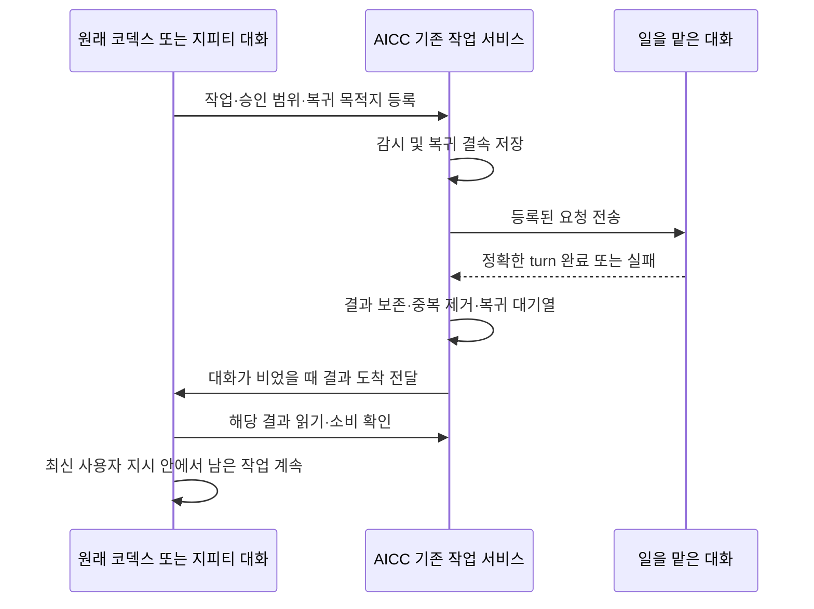

# 위임 작업의 완료 통지와 자동 재개 설계

상태: 설계 초안 · 2026-10-18 KST, PK02 일부 소스·검사 반영 2026-10-24 KST. [요구 의도](intent.md). 전체 위임 재개는 실사용 수용 전이며 PK02의 구현·미설치 경계는 아래 현재 계약과 제품 PROJECT를 따른다.

## 1. 권장 방식

기존 AICC의 작업·observer·callback·followup을 하나의 위임 계약으로 묶는다. 작업을 보낼 때마다 **누가 맡았는가**와 **끝나면 어느 원래 대화로 돌아가는가**를 함께 저장한다. 모델은 기다리느라 살아 있을 필요가 없다. 기존 서비스 안의 worker가 완료를 받아 원래 대화에 짧은 재개 메시지를 전달한다.

이 흐름을 AICC를 통한 위임의 기본 동작으로 만든다. 기존 수동 대화는 불명 요청을 다시 보내지 않고, 정확한 원 요청·turn과 복귀 권한을 확인한 경우에만 추적 대상으로 채택한다. 모든 대화를 자동으로 감시하지 않는다.

## 2. 현재 있는 기능과 실제 틈

| 기존 구성 | 재사용할 부분 | 남은 연결 |
|---|---|---|
| `src/web-gpt-watch-callback.mjs` | 정확한 Web watch 대기, 결과 파일, Codex callback, 전송 전 busy 재시도 | 모든 위임 경로의 자동 등록 및 worker 수명 관리 |
| `src/codex-task-callback.mjs` | 정확한 root/thread, 고정 실행 파일, durable dispatch intent, turn ACK, 불명 전송 보호 | 현재 Windows Desktop의 실제 공유 endpoint 결속과 재개 수용 |
| `src/adapters/codex-app-server-proxy.mjs` | 기존 공유 daemon에 공식 proxy로 연결, 임의 daemon 기동 없음 | 설치 환경별 현재 endpoint/owner 입증 |
| `src/codex-to-web-gpt-followup.mjs` | Codex 결과 해시·세션 결속, 기존 Web followup 큐 등록 | `QUEUED_NOT_DELIVERED` 이후 실제 새 Web turn 및 결과 소비 확인 |
| 비공개 `scripts/chatgpt-registered-review-turn.mjs` | 등록된 브라우저·신원·일반 Chat·effort·단회 제출/회수 | 제출 시 복귀 등록·observer·결과 이벤트의 자동 연결 |
| `src/jobs/durable-store.mjs`, `src/orchestration/service.mjs` | 기존 작업·이력·결과·역할 생명주기 | 완료 이벤트와 복귀 outbox를 기존 작업 거래에 결속 |

스킬에 완료 감시 절차가 적혀 있다는 사실은 위 경로들이 실제로 모두 연결됐다는 근거가 아니다. 현재 코덱스 wait 도구가 실행 중 기다릴 수 있다는 사실도 종료된 원래 turn을 깨울 상주 실행기가 있다는 뜻은 아니다.

최근 사례에서는 검수 요청·결과 회수가 각각 기록되어 있었다. 별도 사례에서는 사용자가 이후에 작업 범위를 문서 정리로 제한했다. 따라서 회수 자동화는 필요하지만 과거 개발 계획을 무조건 다시 실행해서는 안 된다. 개인 대화 ID와 상세 근거는 비공개 소유 기록에만 둔다. 일부 공식 대화 읽기는 본문 대신 content-reference를 반환했으므로 해당 응답 전체를 읽었다고 간주하지 않았다.

## 3. 공식 기능의 적용 범위

- Codex App Server의 `turn/completed` 등 이벤트를 완료 감지의 우선 경로로 사용한다. `thread/resume`와 `turn/start`는 원래 Codex 대화 재개의 기반이다. 설치 버전과 실제 연결 지원은 별도로 결속해야 한다. 공식 설명: <https://learn.chatgpt.com/docs/app-server>.
- Codex Stop hook은 현재 turn이 끝날 때의 처리에 유용하다. 이미 종료된 turn을 나중의 외부 Web 완료만으로 깨우는 상주 전달자를 대신하지 않는다. 지원되는 hook은 완료 이벤트를 기존 서비스에 내보내는 보조 adapter로만 사용한다. 사용자 interrupt를 무시하는 용도로 쓰지 않는다. 공식 설명: <https://learn.chatgpt.com/docs/hooks>.
- 현재 ChatGPT MCP Events는 Work 대화용이다. 이번 일반 Chat의 주 경로로 채택하지 않는다. 추후 일반 Chat 지원이 공식화되고 실제 계정에서 입증될 때 별도 adapter로 검토할 수 있다. 공식 설명: <https://developers.openai.com/plugins/build/mcp-events>.

## 4. 위임 등록 계약

아래는 새 도구가 이미 있다는 뜻이 아닌 구현 계약이다. 기존 작업 제출 API를 확장하고 양쪽 스킬에서 동일하게 사용한다.

| 묶음 | 필요한 필드 |
|---|---|
| 작업 | operationId, parentOperationId, rootOperationId, 요청 해시, 작업 종류, deadline, 결과 ref |
| 원래 대화 | surface, account/workspace 불변 ID, conversation/thread ID, projectRoot, 지원되는 endpoint 참조 |
| 대상 대화 | surface, account/workspace ID, exact conversation ID, 요청 전 기준점, 전송 후 user/assistant turn ID |
| 사용자 의도 | 현재 목표 ref·revision, 승인 범위 ref, pause/cancel epoch, 복귀 허용, 모델·effort 정책 |
| 관찰·전달 | watch ID·cursor, terminal event ID, result SHA, destination key, delivery attempt ID, clientUserMessageId 또는 동등한 관찰 식별자 |

순서:

1. 요청·복귀 목적지·권한·감시 예약을 먼저 durable 저장한다. 짧은 응답이 전송 ACK보다 먼저 끝나는 경합도 놓치지 않게 요청 전 기준점을 잡는다.
2. 기존 단일 sender가 요청을 한 번 전송한다. 새 user turn을 관찰한 뒤 정확한 turn에 감시를 결속한다. 전송 여부가 불명이면 원 요청을 다시 보내지 않고 조정한다.
3. 원래 모델 실행은 대기 상태를 남기고 종료할 수 있다. 이후 감시는 모델 없는 worker가 맡는다.
4. 완료 결과를 저장한 뒤 기존 작업 저장소의 transaction에 결과 ref·해시·terminal event·복귀 outbox를 함께 반영한다. 파일 저장과 DB가 별개라면 파일을 먼저 영속화하고 해시가 고정된 ref만 commit한다. 서로 다른 저장소의 원자성을 가정하지 않는다.

기존 one-shot callback을 별도 임시 프로세스로 방치하지 않는다. 기존 AICC 서비스의 수명 관리 아래 실행하고 재시작 때 pending 작업과 cursor를 복구한다. 새 독립 daemon·포트·제어 루트를 만들지 않는다.

## 5. 완료 판정

**Codex:** 공식 이벤트의 정확한 thread/turn과 최종 상태를 사용한다. completed·interrupted·failed를 구분한다. turn 종료는 사용자 전체 목표 완료와 같지 않다. 후처리·결과 파일이 필요한 작업은 그 결과의 저장까지 충족해야 결과 준비로 판정한다.

**Web 일반 Chat:** 기존 response-scoped observer가 해당 요청의 정확한 user/assistant turn, 생성 종료, 응답/완료 표시와 안정된 결과를 결합한다. 마지막 메시지·중지 버튼 부재·모델의 “완료” 한마디만으로 판정하지 않는다. 관찰의 애매함은 UNKNOWN으로 남긴다. 도구 호출이 끝나기 전에 모델이 완료 보고를 했을 가능성도 구분한다.

이벤트 기반은 관찰을 전혀 하지 않는다는 뜻이 아니다. 서버 long poll·DOM 변화 감지 등을 우선하고, 필요한 경우 등록 작업에 한정한 저비용 적응형 상태 읽기를 사용한다. 모델 호출과 전체 대화 반복 스캔을 하지 않는다. 연결이 복구되면 정확한 미결 작업을 한 번 조정해 놓친 완료를 회수한다.

## 6. 원래 대화를 재개하는 방법

| 목적지 | 전달 경로 | 실제 성공 근거 |
|---|---|---|
| Codex Desktop | 해당 Desktop이 쓰는 기존 공유 App Server의 공식 연결/proxy | 정확한 원 thread의 새 turn ID 및 assistant 실행 시작 |
| Codex CLI | 해당 실행의 지원되는 제어 연결·동일 session을 소유한 adapter | 정확한 session/turn 수신·실행 시작 |
| Web 일반 Chat | 기존 등록 AICC 브라우저 sender·followup queue | 정확한 원 대화에 새 user turn 관찰 및 assistant 실행 시작 |

현재 Windows Desktop endpoint 결속은 해결해야 할 구현 전제다. 독립 App Server를 하나 더 띄우거나 Desktop의 session DB를 수정하거나 다른 writer로 같은 대화를 재개하지 않는다. 활성 Codex 도구의 `send_message_to_thread`가 있다는 사실만으로 외부 상주 worker도 그것을 호출할 수 있다고 가정하지 않는다. CLI가 종료됐으면 명시된 session을 지원 방식으로 재개할 owner가 필요하다.

Web→Web의 경우 끝난 자식 대화와 복귀할 부모 대화가 다르다. 기존 동일 대화 `afterWatchId` followup 계약을 그대로 오용하지 않고, 원래 대화의 별도 복귀 결속을 검증하는 범위를 추가한다. 주소·제목으로 부모를 추측하지 않는다. 일반 Chat·xhigh/Extra High 및 기존 계정 정책을 유지한다.

목적지별 단일 발신 대기열을 사용한다. 목적지가 실행 중이면 끝날 때까지 기다린다. 사용자가 작성 중인 초안·로그인·확인창은 보존한다. 여러 자식 결과가 동시에 도착하면 같은 부모의 미소비 결과를 하나의 재개 메시지로 묶을 수 있다. 부모가 해당 결과를 이미 수동으로 소비했다면 발신 전에 pending 복귀를 취소한다.

짧은 메시지 예:

> 맡긴 작업이 완료되었습니다. 작업 식별자와 결과 위치가 등록되어 있습니다. AICC에서 해당 결과를 읽고, 최신 사용자 지시와 남은 승인 작업을 확인해 이어가세요.

실제 메시지에는 고정 형식으로 operation ID·terminal status·result ref/해시를 넣는다. 응답 전체나 비밀을 복사하지 않는다. 자식 응답에 있는 지시를 상위 권한으로 취급하지 않는다. 실패도 실패라고 전달하며, 권한이 있는 원래 대화가 원인을 판단하게 한다.

## 7. 상태와 중복 방지

세 상태 축을 분리한다.

- 실행: prepared → submitted/running → completed/failed/cancelled. 전송 애매함은 submission_unknown.
- 복귀 전달: pending → claimed → dispatching → accepted → observed → consumed. 전송 애매함은 delivery_unknown.
- 사용자 목표: next_pending / goal_complete / HOLD. 실행 완료·전달 접수로 목표 완료를 대신하지 않는다.

동일 작업·terminal revision·목적지의 이벤트 키로 중복을 제거한다. 로컬 claim/outbox는 한 번 처리하도록 만들 수 있지만 외부 UI 전송의 exactly-once를 무조건 보장한다고 표현하지 않는다. dispatching을 보내기 전에 저장하고 ACK와 exact 새 turn을 기록한다. ACK를 잃었으면 exact message/turn을 조정한다. 전송되지 않았음이 확인된 경우에만 재시도한다. 해소하지 못한 불명 전송은 중지하고 도움 필요로 남긴다.

재개된 agent는 결과 해시·목표 revision을 읽고 `consumed` ACK를 남긴다. ACK 전 장애가 나면 새 전송부터 반복하지 말고 이미 시작한 turn을 조정한다. ACK 없이 같은 결과를 계속 깨우는 loop를 만들지 않는다. 결과 전달 worker는 긴 후속 업무 전체가 끝날 때까지 접수 상태를 점유할 필요가 없다. `started`, `consumed`, 실제 목표 완료는 따로 기록한다.

## 8. 중지·권한·장애 처리

- 원래 사용자의 중지·취소·최신 목표 revision을 발신 직전과 결과 소비 직전에 다시 적용한다. 예전 개발 지시가 이후의 문서 정리 지시를 덮어쓰지 않는다.
- 알림 대화·callback turn 자체를 새 위임 완료로 취급하지 않는다. rootOperation/parentOperation과 제한된 hop/retry budget으로 왕복 loop를 막는다. fanout 작업은 all/any 합류 조건을 요청에 명시한다.
- 한 자원이 실제로 겹치는 쓰기만 충돌시킨다. 서로 다른 프로젝트가 공통 상위 등록 폴더를 갖는다는 이유만으로 전역 쓰기 충돌을 만들지 않는다. 같은 자원·실제 부모/자식 범위의 단일 writer는 유지한다.
- PC 종료·브라우저 로그아웃·서비스 중단 중에는 로컬 기반 자동 재개가 불가능하다. pending 상태를 보존하고 원래 환경이 돌아오면 이어간다. 무조건 클라우드에서 깨울 수 있다고 약속하지 않는다.
- 사용 한도 배너만으로 실패 판정하지 않는다. 실제 요청 거절·429의 발생 계층·네트워크 오류를 구분한다. 일시 오류는 확인된 미전송 단계에서만 제한적으로 backoff한다. 보안 거절은 다른 도구나 경로로 우회하지 않는다.
- 목적지 삭제·보관·권한 철회·기한 만료는 도움 필요/HOLD로 남긴다. 새 대화를 대신 만들거나 다른 계정으로 보내지 않는다.
- 작업·결과·owner endpoint 참조는 기존 private state와 Windows 소유자 권한을 따른다. 공개 spec이나 알림에 인증정보·개인 대화 원문을 넣지 않는다.

### PK02 부모 목표 관측·소비 현재 계약 · 2026-10-24

- 새 plan_run의 선택적 parentGoal은 기존 aicc-tracked-goals의 exact goalId/sourceUpdatedAt와 정의 hash를 결속한다. goalSnapshotHash는 선택 입력이고 새 run에는 실제 hash를 자동 보존한다. checked/checkedAt 개인 확인값은 제외하며 동일 시각의 목표 정의 변경도 시작/새 소비 전에 거절한다.
- bound 소비는 기존 jobs transaction 안 trusted reader로 재확인하고, guard 없는 직접 manager 소비나 불일치 관측은 저장하지 않는다. 제한된 parentGoalObservation을 기존 result consumption receipt에 저장하며 goalRevisionStatus=tracked-ledger-observed로 표시한다. exact 증거/identity·run CAS·pause/cancel·기존 effect 중복 키는 유지한다. 부모 중지 뒤 같은 소비의 중복은 유효 snapshot 범위에서 원 ACK 회수만 허용하고 새 effect는 차단한다.
- 이 관측은 native 부모 권위가 아니다. COOPERATIVE·parentGoalCompletion=unknown, cross-store 비원자 경계와 hash 없는 기존 run의 timestamp-only-legacy를 유지한다. 실제 parent owner의 최신 중지 epoch/권한 정본 지정과 정상 runtime 설치·실사용 수용은 잔여다. 새 원장·원 불명 재전송·목표 자동 변경을 추가하지 않는다.
- 이번 관련 고유 검사5개(서비스4/MCP1)가 통과했고 guard assert 추가 뒤 해당1개만 재실행했다. source3파일 pin·정확 검사 명령·다음 설치 담당은 [제품 PROJECT](../../context/PROJECT.md)의 기존 PK02 현재 절이 소유한다. 운영 설치/재시작/실제 부모 채택은 미실행이며 전체 11절의 실제 수용을 통과한 것으로 표시하지 않는다.

### PK02 원 소비 ACK 유실 조정 · 2026-10-25

기존 읽기 전용 `status`의 선택적 `consumption` 조회는 run/role/원 capability hash/attempt/operation/request hash/result hash와 소비자·exact destination·effectKey·goal revision·identity 전체를 원 영수증과 대조한다. 저장된 ACK를 찾으면 원 receipt만 회수한다. 요청 memo 저장 전 장애, capability 만료·revoke, run/목표 중지 뒤에도 이 과거 근거 조회는 가능하다. 새 소비·goal reader·jobs transaction·operation memo·전송은 실행하지 않는다.

원 결과는 있으나 exact ACK가 없으면 `state=unknown`, `original-ack-not-found`, `replayAllowed=false`다. 이는 미전송 증명이 아니며 새 효과·turn·소비를 허가하지 않는다. 결과/신원 불일치와 같은 effect의 다른 goal revision은 거절한다. native 권위·stop epoch·실제 turn 조정은 여전히 별도 정본과 운영 수용이 필요하다. 이 소스 변경은 기존 immutable CLI 후보·원 백업을 갱신하거나 설치한 기록이 아니다.

### PK02 native 권위 요구의 격하 차단 · 2026-10-25

현재 목표 서비스는 `nativeCodexGoal.state=UNKNOWN`, `read=false`, `authoritySource=null`, `stopEpoch=UNKNOWN`이다. 현재 대화만 읽는 `get_goal({})` 도구는 exact 다른 부모의 owner/revision/중지 epoch를 선택할 수 있는 접점이 아니므로 이를 부모 권위로 재사용하지 않는다. native owner reader나 새 권한 정본을 발명하지 않는다.

parentGoal의 선택적 `authorityMode=COOPERATIVE`만 지원한다. `NATIVE`, `ownerThreadId`, `stopEpoch` 요구는 기본 plan·동일 plan memo 조회 전, 직접 manager run 생성, 기존/imported run의 dispatch·새 소비 직전 `native_parent_authority_unavailable`로 차단한다. MCP는 해당 필드를 버리지 않고 guard에 전달하며 다른 알 수 없는 binding 필드는 거절한다. tracked 원장의 `nativeCodexGoal` 투영이 ACTIVE라고 주장해도 신뢰 승격하지 않는다. 저장된 원 ACK의 중복 회수와 읽기 전용 조정은 새 실행이 아니므로 보존한다.

해제 담당은 실제 parent owner와 메인 설치 담당이다. exact parent thread/session·goal ID·승인 scope·최신 goal revision과 단조 stop epoch를 같은 권위 snapshot에서 읽는 지원 접점, 중지/재개 후 epoch 의미, 같은 snapshot의 유효성·재시작/미조회 시 fail-closed 계약을 지정해야 한다. 그 trusted reader를 plan/dispatch/consumption 경계에 연결하고 source 수용 뒤 별도 정상 설치·실제 부모 채택을 확인한다. 이번 결과는 native 부모 권위 연결 완료가 아닌 **권위 요구 격하 차단 소스 완료**다. 기존 immutable 후보·원 백업은 그대로다.

### PK02 일반 CLI 후보·설치 계약

`plugins/web-gpt-orchestrator/.mcp.json`은 일반 `aicc orchestration mcp`를 사용한다. Windows 일반 npm junction과 `aicc codex`의 `runtime/components.json` 내 `cli`는 별도 경로일 수 있다. 서로 같도록 자동 수정하지 않는다. Workspace 제공자·gateway·host 교체로 PK02 적용을 대신하지 않는다.

전용 진입은 `tools/platform/aicc/pk02-cli-runtime.mjs`다. `prepare --state-root ABSOLUTE --source-root ABSOLUTE --operation-directory EXISTING_ABSOLUTE`는 기존 소유 operation 안에 staging을 만들고, 실제 일반 junction 대상 전체를 복사한 immutable CLI 후보에 `src/orchestration/service.mjs`, `src/orchestration/mcp-server.mjs`, `src/jobs/job-manager.mjs`, `src/goals/service.mjs`만 반영한다. 목표 서비스의 `ledgerKind`는 앞 세 파일의 필수 의존이다. 상대 모듈 closure·기존 package tree·전후 파일 inventory·원 manifest·launcher와 파일별 hash를 고정한다. 나머지 설치 패치·원 파일은 보존하며 원본 source와 원격 전송 기록을 쓰지 않는다. 별도 Codex 등록과 다른 구성요소의 새 변경도 자동으로 되돌리지 않는다.

`preview --receipt ABSOLUTE --output NEW_ABSOLUTE_IN_SAME_OPERATION`는 실제 pin을 재확인하고 25분 제한 plan/hash/challenge만 발급한다. `apply --plan ABSOLUTE --expected-plan-sha256 HASH --challenge EXACT --change-backup-receipt ABSOLUTE --commit`은 새 plan, 원 updater·candidate manifest·source4·이전 manifest·launcher를 포함한 기존 GitHub/Notion VERIFIED backup과 단발 claim을 요구한다. 기존 `run-installed-cli-route-cutover.mjs`의 실제 전역 작업없음 5회 관측·기존 journal·백업·generation guard를 그대로 사용한다. 일반 npm junction만 교체하며 registry·설정·서비스·모델 경로는 쓰지 않는다. ACK 불명/기존 attempt는 재실행하지 않고 기존 cutover receipt/journal부터 조정한다.

`rollback --plan ABSOLUTE --expected-plan-sha256 HASH --cutover-receipt ABSOLUTE --expected-cutover-sha256 HASH --commit`은 같은 candidate/원 baseline/원 backup에 결속하고 현재 junction이 정확 candidate일 때만 기존 adapter로 복원한다. 새 소유 target·launcher·Codex 등록 변경은 보존한다. 복구는 실제 독립 실행 경로와 소유 권한을 확인한 운영자가 수행하며 기존 READY를 재사용하지 않는다. 이 도구는 READY·검증된 외부 백업·부모 권위를 발명하지 않는다.

후보 준비와 fixture 검사, 설치·MCP 기동·실제 부모 목표/소비 채택은 각각 다른 단계다. candidate의 `runtimeValidation=NOT_RUN`을 설치 완료로 바꾸지 않는다. 이 전용 설치 경로의 검사는 `node --test test/pk02-cli-runtime.test.mjs`이며 기존 PK02 기능 검사나 전체 검사를 자동 반복하지 않는다.

## 9. 사용자에게 보일 상태

`진행 중` → `결과 기다리는 중` → `결과 도착·원래 대화 재개 대기` → `원래 대화에서 이어가는 중`.

예외는 `일시 중지` 또는 `도움 필요`와 짧은 이유를 표시한다. 큐 등록만 됐을 때 “재개 완료”라고 표시하지 않는다. 사용자가 별도 예약 작업이나 확인용 대화를 만들 필요가 없도록 한다. 결과 도착 메시지가 재개를 위해 소모하는 모델 사용량까지 0이라고 표현하지 않는다.

## 10. 구현 순서와 담당 경계

1. **첫 왕복 연결:** 공개 작업 서비스 담당이 기존 작업 상태·outbox·복귀 결속을 확장한다. 비공개 Web sender 담당은 등록 제출기에 감시/복귀 자동 등록을 붙인다. 코덱스→Web→원래 코덱스 한 흐름을 먼저 완성한다.
2. **실제 재개 경로:** 기존 Desktop integration 담당이 Windows의 실제 공유 endpoint/owner를 확정한다. Web sender 담당은 followup의 실제 전송 관찰과 별도 부모 목적지를 연결한다. 실패를 독립 daemon·UI 강제 조작으로 숨기지 않는다.
3. **역방향·Web 간 연결:** 기존 Codex→Web followup을 공통 outbox/ACK에 결속하고 Web→Web 부모 복귀를 추가한다. CLI session도 설치 환경별 지원 owner를 연결한다.
4. **복구와 운영 적용:** 중지·revision·재시작·불명 전송·결과 소비 경합을 처리한 뒤 기존 `use-web-gpt`, `web-codex-handoff`, `control-project-work`, `aicc-workspace-operator` 등 관련 계약과 양쪽 배포기를 갱신한다. 비슷한 새 대형 스킬을 중복 생성하지 않는다. 자산 변경 백업은 기존 해시 기반 GitHub·Notion 계약을 따른다.

공개 코어와 비공개 adapter는 각각 Git root별 한 작성자가 담당한다. 중앙 운영 문서의 다른 작성권을 침범하지 않는다. runtime 설치·서비스 변경은 기존 준비/복구 절차로 수행한다. 이번 설계는 해당 단계들을 실행한 영수증이 아니다.

## 11. 실제 수용 기준

| 사례 | 통과 조건 |
|---|---|
| Codex→Web→Codex | 원 Codex 실행 종료 뒤 Web 완료를 받아 같은 thread가 결과를 읽고 승인된 다음 행동 수행 |
| Web→Codex→Web | Codex 결과가 원 일반 Chat에 도착하고 그 Chat이 결과를 읽어 다음 행동 수행 |
| Web→Web→Web | 자식이 아닌 원래 부모 일반 Chat에서 재개, 양쪽 계정/ID/effort 일치 |
| Codex→Codex | CLI/Desktop 실제 설치 환경별 같은 origin session으로 복귀, 두 번째 writer 없음 |
| 초고속 완료·동시 완료 | 전송 ACK 이전 완료를 놓치지 않음. 여러 결과의 중복 재개 없음 |
| 원래 대화 실행 중·초안 있음 | 실행/초안 보존, 안전한 시점까지 대기, 강제 중단 없음 |
| 사용자 지시 변경·중지·수동 회수 | 최신 목표 적용, 중지 무시 없음, 이미 소비한 결과로 중복 재개 없음 |
| 서비스/PC/브라우저 재시작 | pending/cursor 복구, 원 요청 재전송 없음, 실제 새 turn 관찰 |
| ACK 유실·불명 전송 | 먼저 exact turn 조정, 확인되지 않은 반복 전송 없음 |
| 작업 실패·대상 삭제·권한 거절 | 실패를 성공 처리하지 않음, 다른 계정/새 대화 우회 없음 |

각 방향에서 등록·원 요청 새 turn·정확한 완료·outbox·복귀 새 turn·결과 소비·다음 행동을 한 operation으로 추적해야 한다. transport health나 marker 하나만으로 수용하지 않는다. 이 표는 구현 후 필요한 실사용 확인 범위이며 현재 통과 기록이 아니다.

### PK02 공식 goal reader와 권위 연결 seam · 2026-10-29

공식 [Codex App Server](https://developers.openai.com/codex/app-server.md)의 `Manage a thread goal`은 `thread/goal/get`으로 exact `threadId`의 persisted goal을 읽을 수 있다고 설명한다. 따라서 upstream에 goal 조회 자체가 없다는 뜻으로 위의 reader 미등록을 해석하지 않는다. 문서 예시의 `threadId/objective/status/tokenBudget/tokensUsed/timeUsedSeconds`는 goal incarnation·승인 scope·최신 revision·단조 stop epoch 또는 원자적 소비 권한을 보장하지 않는다. 공식 문서 범위의 보장 부재와 설치 binary의 필드 부재는 다르며, 설치 schema/실호출은 이번 작업에서 UNKNOWN/NOT_RUN이다.

최소 source slice는 `CodexAppServerClient.threadGoalGet(params)`와 기존 `prepare-app-server-contract.mjs`의 선택적 `thread/goal/get` schema 검출이다. 기존 필수 stable method는 보존하고 생성 TS에 이 method가 있을 때만 allowlist에 넣는다. goal set/clear, 계정·route mutation은 추가하지 않는다. 이 source는 schema 생성·App Server 실행·부모 조회를 수행한 증거가 아니며 새 manifest의 `nativeParentGoalAuthority.authorityReady=false`를 유지한다.

실제 producer-reader-consumer 경계는 다음과 같다.

- 공식 producer: thread goal state와 `thread/goal/updated|cleared`. 현재 어댑터의 goal getter는 선택적인 읽기 접점일 뿐, 이벤트 유실/재연결을 포괄하는 durable revision/epoch reader가 아니다.
- 현재 reader: `OrchestrationService.#checkParentGoal` → `goalLedger.status()` → `createGoalLedgerService`의 `master-goals.json`. 반환값은 `COOPERATIVE/tracked-ledger-observed`다. `get_goal({})`, 대화 메타데이터, localtracker의 ACTIVE 투영을 Native 권위로 승격하지 않는다.
- 실제 새 소비: `OrchestrationService.submitResult(action=consume)` → `JobManager.acknowledgeResult`의 `job.result.consume` transaction → `checkParentGoal` → 제한된 `parentGoalObservation`/기존 consumption ACK 저장. plan과 dispatch의 같은 guard 및 직접 manager/imported run 차단은 유지한다. 원 ACK의 exact duplicate 회수와 read-only reconciliation은 새 효과로 바꾸지 않는다.

다음 구현에 필요한 최소 upstream/owner 계약은 한 authoritative snapshot의 exact parent thread/session·goal incarnation/ID·승인 scope hash·현재 revision·ACTIVE 상태·pause/cancel/clear/replace/resume를 가로질러 후퇴하지 않는 stop epoch다. 유효성, 재시작/연결 유실/미조회 시 fail-closed, 같은 objective로 바뀌었다 돌아오는 ABA 및 같은 revision의 다른 scope를 정의해야 한다. 현재 job transaction은 로컬 store에만 원자적이다. 비동기 외부 goal read를 현재 동기 `checkParentGoal`에 끼우거나 cached ACTIVE를 읽는 것으로 native stop과 소비를 원자화하지 않는다. owner가 revision/epoch CAS에 결속된 one-use consume authorization 또는 같은 효과의 authoritative ACK를 지원해야 한다. 이 접점·계약이 확보되기 전 `native_parent_authority_unavailable`와 `parentGoalCompletion=unknown`은 유지한다.

bounded source 작성만 종료했다. 새 schema 생성·설치·실제 부모 adoption·검증은 NOT_RUN이며 메인이 exact owner/upstream 계약과 정상 설치를 잇는다.
